# Helium Leak Detector Data Logger

A Raspberry Pi system that records the analog output of an industrial helium leak detector during production leak tests. Each test is tagged with the operator and the production order barcodes, saved as a CSV on the Pi, and uploaded to an InfluxDB time-series database.

Built in summer 2021 during an automation engineering internship.

## Why

- A leak detector gives a pass/fail result, but it keeps no permanent record of the test.
- Customers were asking for the data behind a "leak checked" stamp on a production order.
- The goal was a low-cost device that runs from a touchscreen alone and can be copied to the other detectors in the facility.

## My role

- Sole developer: hardware selection and wiring, the voltage divider board, the GUI and logging code, the InfluxDB setup and charts, the housing design, the bill of materials and the documentation.

## How it works

```
detector DB25 connector
  pins 14/15: leak signal, 0-8 V ------+
  pins 19/15: inlet pressure, 0-10 V --+--> voltage dividers --> AD/DA board --+
                                                                              |
helium line --> flow sensor ------------------------------------> GPIO 23 ----+--> Raspberry Pi 3B+
USB barcode scanner --> production order, material #, quantity, serial #  ----+      Tkinter GUI on a touchscreen
                                                                                        |            |
                                                                                   CSV on the Pi   InfluxDB
```

## Hardware

| Part | What it does |
|---|---|
| Raspberry Pi 3 Model B+ | Runs the GUI and logging code |
| Waveshare High-Precision AD/DA board | 8-channel, 24-bit ADC (ADS1256) that reads the detector's analog outputs |
| DB25 breakout board and serial cable | Taps the signals from the back of the detector |
| Voltage divider board (Fritzing PCB, Pi HAT shaped) | Scales the detector's 0-8 V and 0-10 V outputs down to a level the ADC can read |
| Flow meter sensor | Sits on the helium line and counts paddle-wheel revolutions on GPIO 23 (needs at least 15 psi in the line) |
| USB barcode scanner | Scans the production order paperwork |
| Raspberry Pi touchscreen in a stand (800x480) | The operator interface, usable without a mouse or keyboard |
| 3D-printed housing | Body and sliding lid, with a cord opening and ventilation for the Pi |

Parts for the breadboard version came to about $200. The version with the custom divider board and terminal blocks was about $215, not counting the printed housing.

### Signal wiring

The pin numbers come from the detector's manual. Pin 15 is the detector's internal ground.

| Signal | DB25 pins | Range | Divider (top / bottom) | ADC channel |
|---|---|---|---|---|
| Leak rate | 14 and 15 | 0-8 V | 4.7 kOhm / 2.2 kOhm | 2 |
| Inlet pressure | 19 and 15 | 0-10 V | 2.2 kOhm / 1 kOhm | 3 |

The dividers can't just be a regulator, because the code needs to see the voltage change. The code undoes the division using the resistor values measured with a multimeter. The board has two more divider slots (0 Ohm placeholders) for future signals.

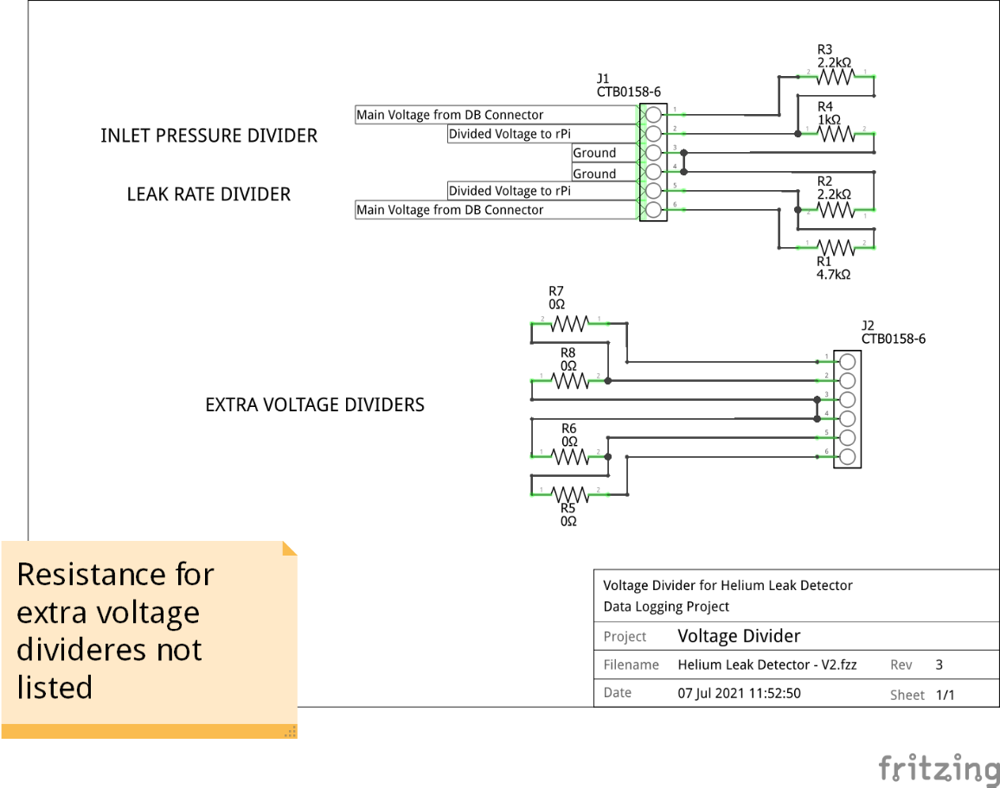

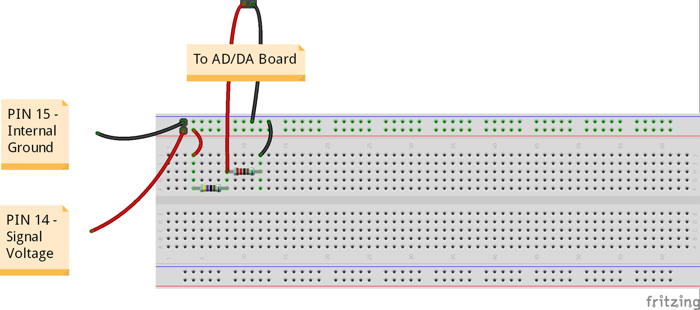

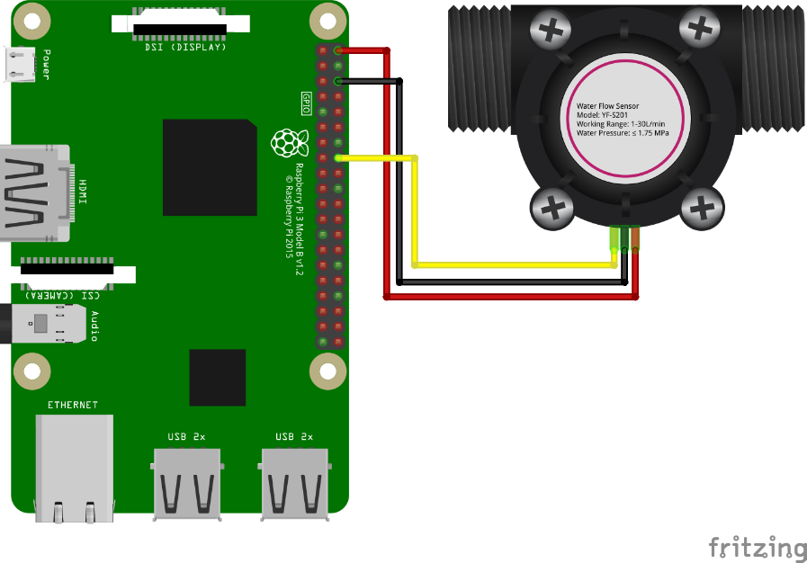

The board design is in [`hardware/helium-leak-detector-v3.fzz`](hardware/helium-leak-detector-v3.fzz). Open it with [Fritzing](https://fritzing.org), which is free.

### Housing

I designed a 3D-printed housing to hold the whole unit: a body with an opening for the cords and a sliding lid with ventilation slots to keep the Pi cool.

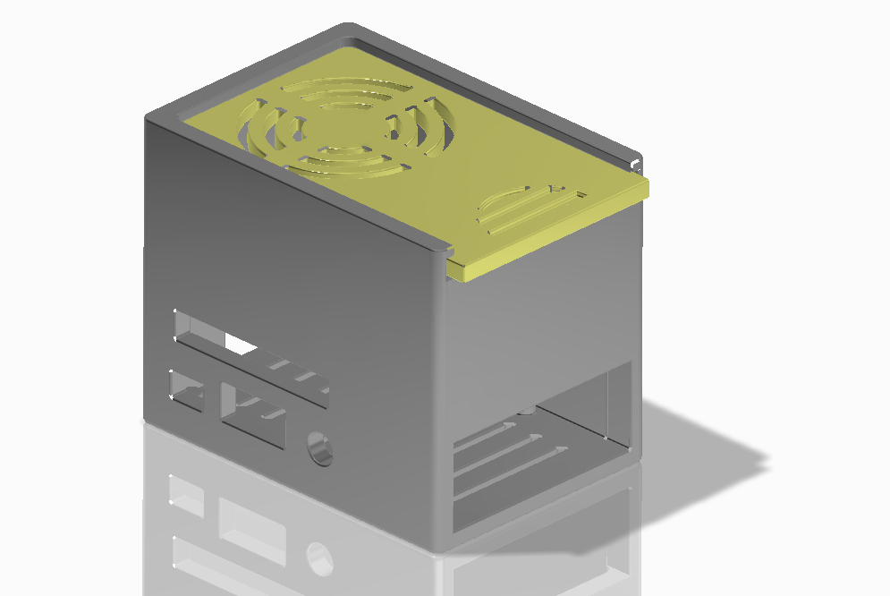

## Converting voltage to leak rate and pressure

**Leak rate.** The detector's analog output is logarithmic. Its manual has a table of output voltage against helium signal in two modes: fine leak (FL) and gross leak (GL), where GL is 100 times FL. No single equation fit the table well, so the code interpolates between the table points with SciPy's `interp1d`. A (0 V, 0) point is added so readings under 0.10 V still convert, to a value near zero. Units are mbar l/s. The table is in [`data/voltage_to_leak_rate.csv`](data/voltage_to_leak_rate.csv), and the same values are built into the GUI code.

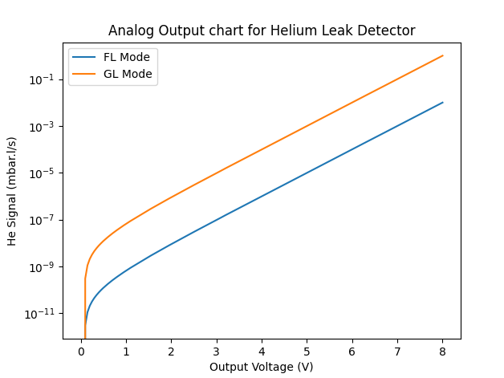

**Inlet pressure.** The manual has no table for this one. The output is 0-10 V, and the detector's inlet has two settings: a rest position at about 200 mbar and a vacuum position at about 0.001 mbar. The code interpolates between four points matched by hand:

| Output voltage | Inlet pressure |
|---|---|
| 0 V | 0 mbar |
| 2.45 V | 0.001 mbar (vacuum) |
| 7.07 V | 200 mbar (rest) |
| 10 V | 1000 mbar |

These are estimates, so treat the pressure channel as approximate.

## The GUI

The GUI is written in Python with Tkinter and starts from a desktop icon (`He_Leak_Detector.desktop`).

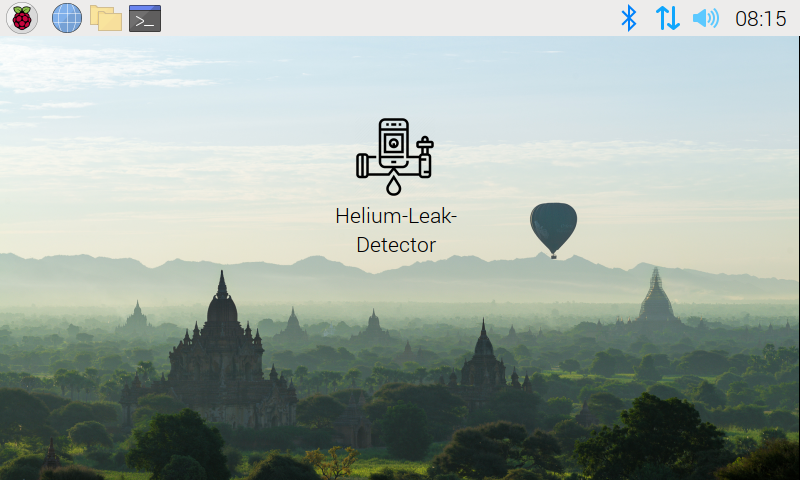

1. **Log in.** The operator types a PIN on the on-screen keypad. PINs are looked up in a SQL database. With no network, the GUI checks a local `operators.csv` instead.
2. **Scan.** The barcode scanner fills in the production order, material number, quantity and serial number (optional), and the cursor moves to the next box on each scan. **Clear All** starts over, and not every field has to be filled.
3. **Record.** **Start Recording** shows a TESTING... indicator and a stopwatch. The code samples roughly every 0.1 seconds.
4. **Finish.** **End Recording** saves the test as a CSV on the Pi. If the network is up, the GUI uploads it to InfluxDB and shows the progress.
5. **Offline.** If the upload fails, the GUI shows UPLOAD FAILED and keeps the file name in `Failed_Uploads_to_InfluxDB.txt`. The **Upload Failed Test** window sends those files later with their original timestamps.

| | |
|---|---|
| 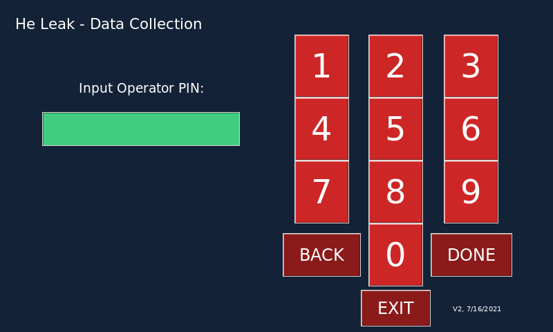 | 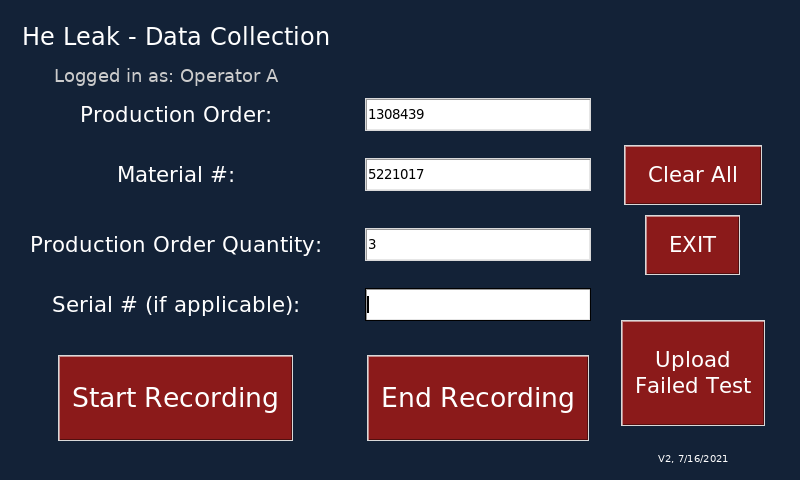 |
| 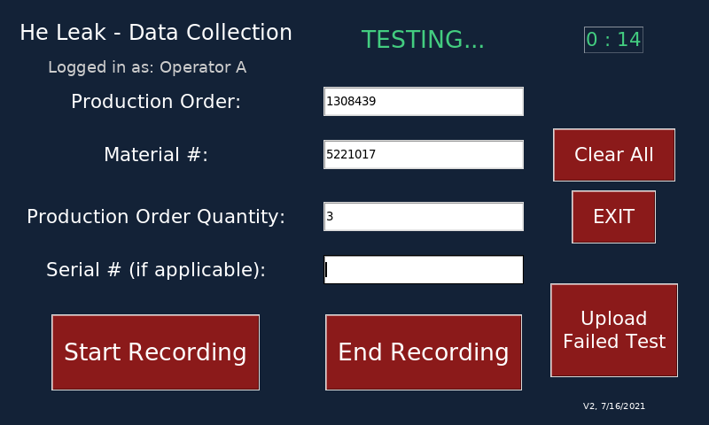 | 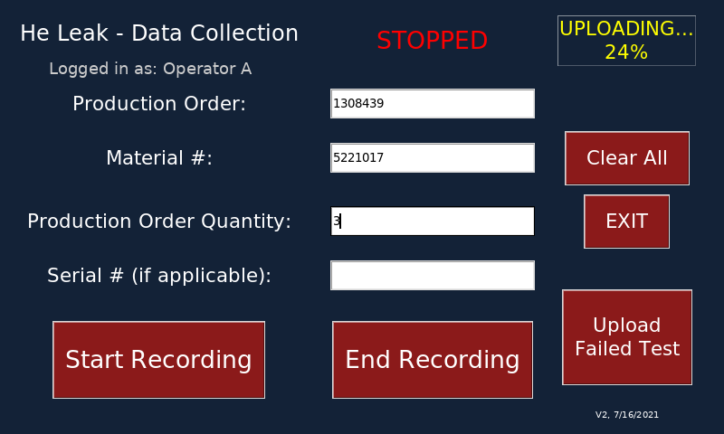 |
| 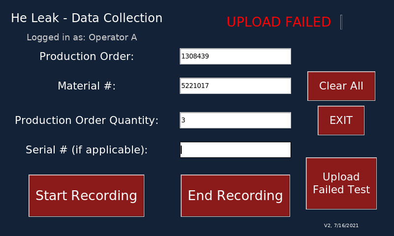 | 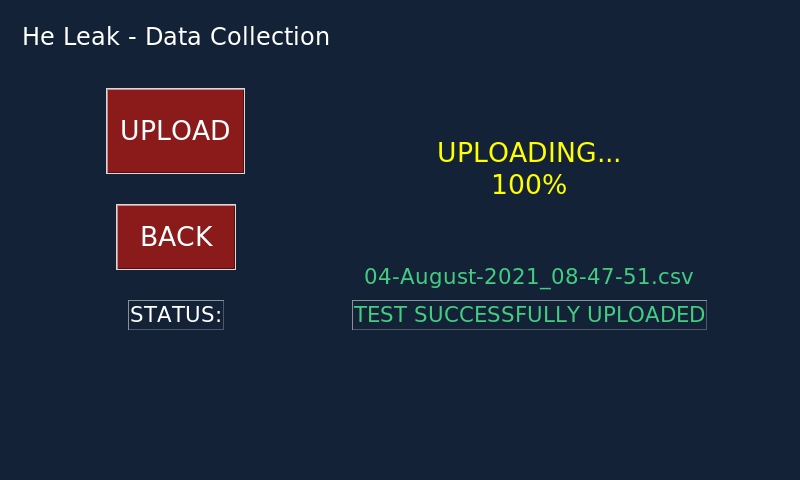 |

## Data

**CSV.** Every test is saved in `/home/pi/Data_Logging` with a timestamp as the file name, for example `04-August-2021_08-47-51.csv`. Empty fields stay blank. Columns:

| Column | Notes |
|---|---|
| Time | UTC timestamp, about every 0.1 s |
| Operator, Production Order, Material #, Quantity, Serial # | Entered by login and barcode scans |
| Leak Rate | mbar l/s |
| Inlet Pressure | mbar |
| He_Flow_Rate | Paddle-wheel revolutions per 0.1 s, usually 0, 1 or 2 |

[`SAMPLE_DATA_2.csv`](SAMPLE_DATA_2.csv) is an example test. The operator and order numbers in it are placeholders.

**InfluxDB.** Each row is written with the operator, production order, material number, quantity and serial number as tags, and the leak rate, inlet pressure and helium flow as fields. In the Data Explorer you can filter by any tag and zoom to a test. In the example below, three bursts of helium flow line up with three peaks in the leak rate.

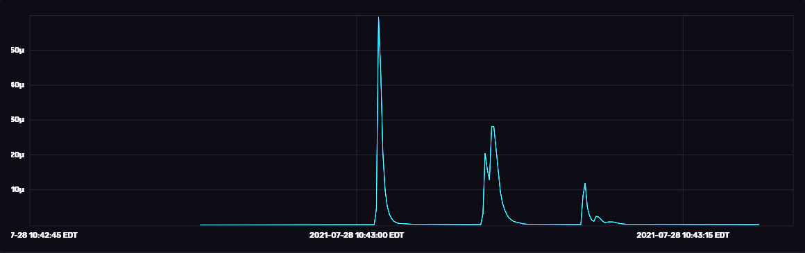

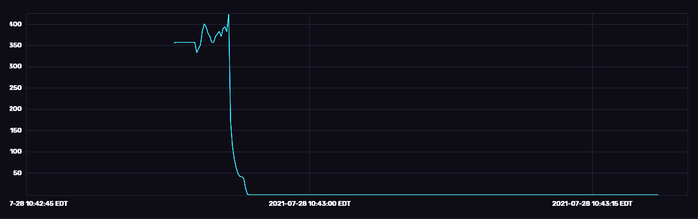

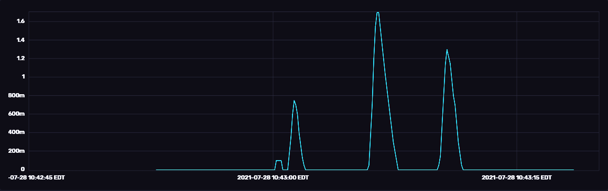

## Running it

The code was written for a Raspberry Pi 3B+ and Python 3. It needs SPI enabled and these packages: `RPi.GPIO`, `spidev`, `influxdb-client`, `pandas`, `scipy`, `pytz` and `mysql-connector-python`. Tkinter comes with Raspberry Pi OS.

- The code and the `.desktop` file expect the project in `/home/pi/Helium_Leak_Detector` and the CSV folder at `/home/pi/Data_Logging`.
- **Credentials are placeholders.** Put your own InfluxDB URL, org, bucket and token near the top of `He_Leak_Detector_Data_Logger_GUI.py`, and your own SQL settings in the PIN lookup (or use `operators.csv` only).
- `Test_Flow_Sensor.py` is a quick check that the flow sensor pulses are being counted.

## Repository layout

```
AD-DA-Test/
  He_Leak_Detector_Data_Logger_GUI.py   the GUI and data logger
  ADS1256.py, config.py                 ADC driver, from Waveshare's public example code
  main.py                               prints all 8 ADC channels
  CSV_To_InfluxDB.py                    uploads a recorded CSV to InfluxDB
  Test_*.py                             small tests for the flow sensor, CSV and InfluxDB writes
He_Leak_Detector.desktop                desktop launcher for the Pi
SAMPLE_DATA_2.csv                       example recorded test
data/voltage_to_leak_rate.csv           output voltage to leak rate table
hardware/helium-leak-detector-v3.fzz    Fritzing project for the voltage divider board
docs/images/                            screenshots and diagrams used in this README
```

## Data and privacy

No operator names, PINs, credentials or production data are in this repo. The sample CSV uses placeholders, and the screenshots were edited to replace the operator's name.

## Credits

The ADC driver files are adapted from Waveshare's public example code. The voltage-to-leak-rate table comes from the leak detector's user manual.
